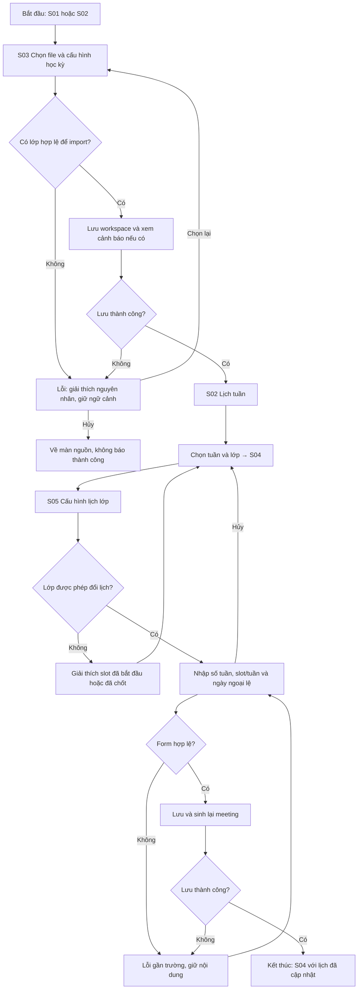
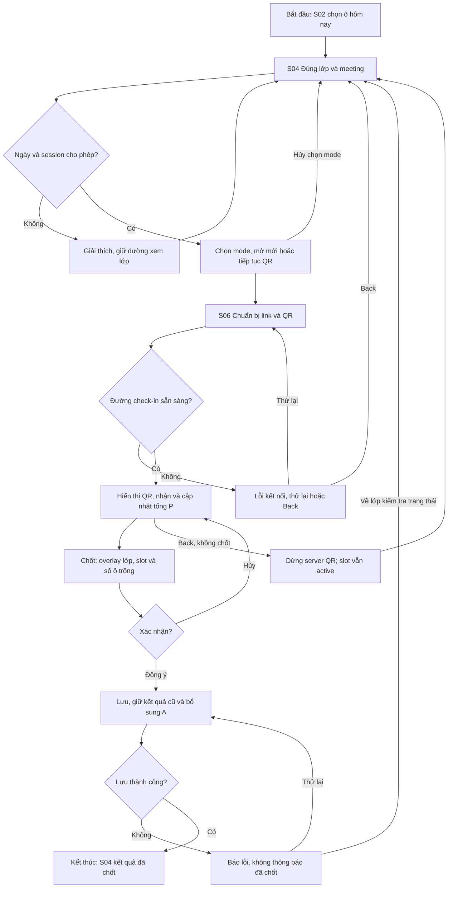
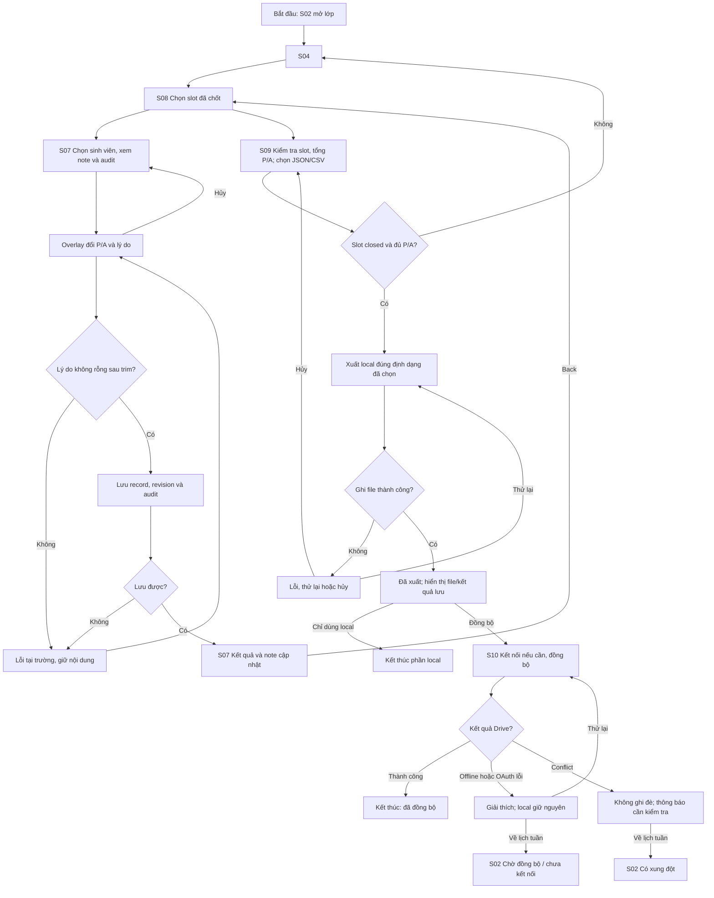

# User flow — FAP Attendance Mobile

Cập nhật 22/10/2026. Prototype hiện dùng [Stitch](https://stitch.withgoogle.com/preview/10059602616228007293?node-id=f4c596c319264fa182ad8c2c92ebf951); sơ đồ là hành vi mục tiêu, không chứng nhận mọi nhánh đã nối. Xem [review](../design/prototype-review.md), [P01](persona.md), [ma trận nhu cầu–UI–test](traceability.md) và [bộ màn hình gốc](../design/screen-evidence.md). Figma ngoài phạm vi sửa lần này. Chỉ dùng ảnh sinh viên đã gửi, không tạo màn hình mới.

## Mục đích và phạm vi

Thiết kế cho giảng viên Trường Đại học FPT, theo nghiệp vụ source cũ `Project_PRM393`. Đây là prototype mobile cho Lab 2, không phải chứng nhận Android hoặc tích hợp mạng đã triển khai. Persona ở [persona.md](persona.md), quy tắc giao diện ở [DESIGN.md](../design/DESIGN.md).

Sinh viên dùng trình duyệt để check-in. Trang sinh viên và extension desktop là hệ thống liên quan, không tính vào màn hình giảng viên hoặc yêu cầu thao tác trong ba flow.

## Information architecture

### Danh sách màn hình

| ID | Màn hình | Cấp điều hướng và ngữ cảnh |
| --- | --- | --- |
| S01 | Bắt đầu workspace | Điểm vào khi chưa mở workspace; email nhận diện, markbook hoặc Drive |
| S02 | Danh sách lớp / thời khóa biểu tuần | Cấp cao khi có workspace; hai chế độ, tuần trước/sau, tuần này, mọi lớp và Quản lý lớp |
| S03 | Import markbook | Tác vụ từ S01/S02/S10; ODS/XLSX và cấu hình học kỳ |
| S04 | Điểm danh lớp | Cấp con của lớp; giữ class ID, meeting ID và tuần nguồn mở |
| S05 | Cấu hình lịch lớp | Từ S04/Quản lý lớp; chỉ lưu được khi chưa có slot active/closed |
| S06 | Điểm danh QR | Từ meeting hôm nay chưa chốt; mở mới hoặc tiếp tục slot active |
| S07 | Chi tiết sinh viên | Từ roster S04 hoặc kết quả S08; giữ sinh viên và meeting đang xem |
| S08 | Lịch sử điểm danh lớp | Từ S04; danh sách meeting, kết quả và tổng P/A của lớp này |
| S09 | Xuất kết quả | Từ meeting đã chốt trong S04/S08; một lớp/một meeting |
| S10 | Google Drive và đồng bộ | Cấp cao khi có workspace; cũng có thể mở từ S01 để kết nối/chọn nguồn |

### Cấu trúc điều hướng

```text
Chưa có workspace
  S01 Bắt đầu
    S03 Import local
    S10 Kết nối Drive → chọn nguồn → S03

Có workspace
  Lịch tuần & danh sách lớp — S02
    Import/cập nhật — S03
    Ô meeting / Quản lý lớp — S04
      Cấu hình lịch — S05
      QR — S06
      Chi tiết sinh viên — S07
      Lịch sử lớp — S08
        Chi tiết sinh viên — S07
        Xuất kết quả — S09
      Xuất kết quả — S09
    Quản lý lớp → chỉnh lịch S05 hoặc xác nhận xóa
  Drive — S10
    Đồng bộ/thử lại
    Chọn markbook được quyền truy cập → S03
```

S02 và S10 là hai điểm đến cấp cao khi có workspace; màn con dùng Back. Trước khi có workspace, S10 giữ Back về S01, không hiển thị dashboard có dữ liệu giả như đã import.

Danh sách lớp và Lịch tuần là hai chế độ của S02. Cả class card/meeting trong danh sách và ô lịch đều mở đúng lớp/slot; giữ chế độ, tuần và bộ lọc khi Back. Nút cấu hình lớp chưa bắt đầu trong S02 có thể mở thẳng S05, không bắt buộc đi qua S04.

Dialog xác nhận chốt/xóa, sửa P/A, chọn chế độ QR và các trạng thái loading/error không tính là màn hình riêng.

### Điều hướng từ lịch tuần

- Cột thứ Hai–Chủ Nhật kèm ngày, hàng slot 1–4; ngày hiện tại có nhãn Hôm nay và màu nhấn.
- Mỗi ô chứa meeting theo ngày thật, gồm học bù và nhiều lớp trùng lịch. Không suy ra chỉ từ mã lịch lặp.
- Bấm một meeting mở S04 với đúng class ID và meeting ID; Back về đúng tuần trước đó.
- Đổi tuần chỉ thay vùng xem, không sửa lịch hoặc kết quả. Tuần này về tuần hiện tại bằng một thao tác.
- Tuần trống có hướng chọn tuần khác, không bị hiểu là chưa có roster.
- Mobile cuộn ngang vùng ngày, nhãn slot ngoài vùng cuộn ngang; không ép bảy cột bằng giảm font.
- Quản lý lớp cho mở lớp không có meeting trong tuần, chỉnh lịch hoặc xóa có xác nhận.

## Flow 1 — Import và cấu hình lịch lớp

### Mục tiêu, điều kiện và kết thúc

**Mục tiêu:** Tạo/cập nhật workspace và thiết lập lịch riêng cho một lớp trước khi điểm danh.

**Điểm bắt đầu:** S01 nếu chưa có workspace, hoặc S02 nếu cập nhật dữ liệu.

**Điều kiện:** Có ODS/XLSX local hoặc nguồn Drive được app truy cập. Lớp cần đổi lịch chưa có slot active/closed, kể cả slot quá ngày được tự chốt.

**Kết thúc thành công:** Workspace và lịch lớp được lưu; S04 hiển thị lớp, các meeting mới và thông báo kết quả. Không báo thành công nếu ghi file lỗi.

### Sơ đồ



### Happy path

1. Nhập email ở S01 để nhận diện workspace; không mô tả đây là xác thực quyền sở hữu email.
2. S03 chọn ODS/XLSX, học kỳ, ngày bắt đầu, số tuần và một/hai slot mỗi tuần.
3. Import loading, ngăn bấm lặp. Nếu vẫn có lớp hợp lệ, lưu dữ liệu và cho xem cảnh báo sau import nếu có.
4. S02 mở tuần hiện tại. Nếu học kỳ nằm ngoài tuần này, chọn tuần phù hợp hoặc mở lớp qua Quản lý lớp.
5. Mở S04 đúng lớp/meeting, đến S05 khi lớp chưa có active/closed.
6. Nhập số tuần 1–52, slot/tuần 1 hoặc 2; nếu một slot thì chọn một ngày trong nhóm lịch. Chọn ngày nghỉ/học bù hợp lệ.
7. Lưu, sinh lại meeting và về S04. Danh sách tuần cập nhật khi quay lại S02.

### Nhánh thay thế và phục hồi

| Tình huống | Phản hồi và cách tiếp tục |
| --- | --- |
| Hủy file/form | Về nguồn mở; không báo đã import/lưu |
| File sai hoặc không có sheet hợp lệ | Lỗi dễ hiểu và Chọn lại; không tự đưa người dùng đến dashboard thành công |
| Có sheet/dòng bị bỏ qua | Hiển thị cảnh báo sau import; không mặc định mọi cảnh báo chặn cả workbook |
| Import cùng học kỳ | Merge roster/lớp, giữ lịch riêng và lịch sử lớp cũ. Lớp/SV vắng trong file mới không tự xóa; SV thêm vào slot chốt được bổ sung A theo source |
| Nguồn Drive | S01/S02 → S10 kết nối → chọn nguồn app được quyền truy cập → S03; không giả định truy cập toàn bộ My Drive |
| OAuth bị hủy/chưa có nguồn | Giữ Back và thử lại hoặc chọn local, không báo kết nối/import thành công |
| Lớp đã active/closed | Chặn lưu đổi lịch, giải thích. Chỉ quay về xem lớp; không hứa tự sửa lịch tương lai mà source chưa hỗ trợ |
| Form hoặc ghi file lỗi | Giữ nội dung và ngữ cảnh, có thử lại/hủy; không cam kết đã rollback toàn bộ dữ liệu nếu chưa có bằng chứng |

**Trạng thái cần vẽ:** form mặc định, đang import, lỗi file, import có cảnh báo, tuần trống, lịch không được phép sửa, form sai và lưu thành công.

## Flow 2 — Mở QR và chốt danh sách

### Mục tiêu, điều kiện và kết thúc

**Mục tiêu:** Nhận check-in đúng lớp/slot hôm nay và chốt có xác nhận.

**Điểm bắt đầu:** S02.

**Điều kiện:** Có roster; meeting hôm nay chưa chốt; chỉ một slot active trên workspace. Slot active hiện tại có thể mở lại QR, nhưng slot đã closed thì không.

**Kết thúc thành công:** S04 hiển thị đủ P/A, meeting đã chốt và không còn nhận check-in. Hai phút của sinh viên không tự kết thúc flow này.

### Sơ đồ



### Happy path

1. Bấm ô có mã môn/lớp và ngày/giờ trên S02. S04 chọn chính meeting đã bấm.
2. Nếu chưa mở, chọn mode và bắt đầu session. Nếu active cùng slot, mở QR để tiếp tục; không gọi bắt đầu session mới.
3. S06 chỉ báo sẵn sàng khi đường check-in hoạt động. Sinh viên khác mạng cần link công khai, không dùng localhost.
4. QR đổi 15 giây. Mã bí mật sáu chữ số giữ nguyên trong một lần bật chế độ, bật lại tạo mã mới.
5. Mỗi challenge sinh viên có hai phút; UI giảng viên hiển thị quy tắc ngắn, không đặt đồng hồ tự chốt cả lớp.
6. Theo dõi số có mặt. Bấm Chốt mở overlay ghi rõ lớp, slot, ngày và số ô trống sẽ thành A.
7. Đồng ý lưu: giữ P/A đã có, bổ sung A cho ô chưa ghi nhận, ngừng nhận và trở lại S04 sau thành công.

### Nhánh thay thế và phục hồi

| Tình huống | Phản hồi và cách tiếp tục |
| --- | --- |
| Slot quá ngày/tương lai/closed | Không mở QR, giải thích; vẫn xem được lớp/lịch sử |
| Session khác active | Báo lớp/slot cần xử lý, cho quay về session đó trước khi mở lớp khác |
| Hủy xác nhận chốt | Đóng overlay, tiếp tục S06; không đổi kết quả |
| Link chưa sẵn sàng | Loading/lỗi và thử lại hoặc Back; không báo sinh viên có thể truy cập |
| Back khỏi S06 | Dừng server/tunnel của trang, giữ slot active và kết quả. S04 không nói QR còn nhận; cùng ngày bấm Mở QR để tiếp tục |
| Sinh viên hết hai phút | Nếu session và QR còn nhận, quét QR hiện tại để lấy challenge mới. Không cần chốt/mở lại slot |
| Slot đã chốt | Không mở lại QR; sửa P/A có lý do bằng flow 3 |
| Lỗi lưu khi chốt | Không điều hướng như đã lưu. Giữ cách thử lại/kiểm tra trạng thái, không giả định tự rollback hoặc QR còn nhận |
| Local lưu được, Drive lỗi | Báo đã lưu local/chờ đồng bộ; không coi đây là mất kết quả hoặc yêu cầu chốt lại |
| App mở lại sau ngày học | Kiểm tra lịch và hoàn tất slot quá ngày; record thiếu thành A, kết quả đã có giữ nguyên |

**Trạng thái cần vẽ:** chọn mode, đang chuẩn bị QR, QR sẵn sàng, có lượt P, lỗi kết nối, xác nhận/hủy chốt, đang lưu và kết quả đã chốt. Có thể mô phỏng chuyển tiếp bằng dữ liệu giả, không ghi là check-in thật.

## Flow 3 — Xem ghi chú, sửa, xuất và đồng bộ

### Mục tiêu, điều kiện và kết thúc

**Mục tiêu:** Sửa kết quả có truy vết, xuất JSON/CSV đúng slot và hiểu trạng thái lưu/Drive.

**Điểm bắt đầu:** S02, với dữ liệu slot đã chốt.

**Điều kiện:** Có workspace và kết quả; được sửa active/closed nhưng không upcoming. Flow demo ưu tiên closed để xuất được. Drive không bắt buộc.

**Kết thúc thành công:** Note/audit và file local đúng định dạng đã chọn; Drive đã đồng bộ hoặc rõ trạng thái chờ/xung đột nếu chọn sao lưu. Chưa kết nối Drive không chặn hoàn thành phần local. Thành công trong prototype là mô phỏng, không xác minh tạo file hay schema extension.

### Sơ đồ



### Happy path

1. S08 hiển thị meeting theo ngày, trạng thái và tổng P/A của lớp.
2. Chọn sinh viên để S07 hiển thị lịch sử, tỷ lệ vắng, note hiện tại và audit trước/sau theo meeting.
3. Bấm icon note để xem, hoặc chọn sửa. Overlay giữ rõ sinh viên, lớp, slot và kết quả cũ.
4. Chọn P/A, nhập lý do không rỗng sau trim. Lưu cập nhật một JSON chính của slot, tăng revision và thêm auditEvents, không hai file final/correction riêng.
5. S07 vẫn hiển thị kết quả đã sửa và icon note; Back về S08 với cùng meeting đang chọn.
6. S09 xác nhận học kỳ, môn/lớp, số thứ tự slot học, ngày/giờ, tổng P/A; chọn JSON dành cho extension desktop hoặc CSV trao đổi. Chỉ xuất một lớp/một meeting closed đủ kết quả. Đổi format đổi đuôi; tên preview/result/share phải giống nhau. Schema JSON chưa được xác minh với extension.
7. Báo thành công sau ghi file; cho biết nơi lưu/kết quả. Source dùng exports local, không mặc định đã có hộp thoại chọn đường dẫn.
8. Có thể kết thúc ở local, hoặc mở S10 để kết nối/đồng bộ. UI phản ánh trạng thái thật; prototype chỉ mô phỏng.

### Nhánh thay thế và phục hồi

| Tình huống | Phản hồi và cách tiếp tục |
| --- | --- |
| Note sau ngày học | Vẫn xem được bằng icon; không dùng ổ khóa thay P/A |
| Lý do trắng/toàn khoảng trắng | Lỗi ngay tại trường, giữ overlay/nội dung, chưa báo lưu |
| Hủy sửa | Đóng overlay, giữ kết quả cũ |
| Lỗi lưu | Giữ ngữ cảnh, thử lại hoặc hủy; không báo đã sửa |
| Slot chưa bắt đầu | Không sửa, giải thích. Slot quá ngày được xử lý thành closed trước khi sửa |
| Tỷ lệ vắng | Mẫu số tổng meeting đã lên lịch, kể cả tương lai; không dùng số đã chốt làm mẫu số |
| Export chưa đủ điều kiện | Chặn, giải thích, quay về đúng slot ở S04 |
| Hủy chọn nơi lưu nếu thiết kế thêm | Không tạo thông báo thành công; đây là tương tác mobile đề xuất |
| Chưa có Drive | Vẫn hoàn thành local; kết nối sau, OAuth hủy không làm mất file |
| Bấm đồng bộ nhiều lần | Nút loading/disabled khi đang chạy; không tạo file trùng có chủ ý |
| Offline | PendingSync nếu đã kết nối/có thay đổi; không đổi thành Synced giả |
| Conflict | Không tự ghi đè; giữ trạng thái Có xung đột, cho Back. Không thêm bộ merge/chọn phiên bản như đã triển khai |

**Trạng thái cần vẽ:** lịch sử có dữ liệu, note, overlay sửa, lý do trống, đang lưu, kết quả sửa, export loading/thành công/lỗi, Drive chưa kết nối/đang đồng bộ/pending/synced/conflict.

## Quy tắc Back và trạng thái ngữ cảnh

| Vị trí | Back / Hủy |
| --- | --- |
| S03 | Về S01/S02/S10 đã mở, không báo import thành công |
| S04 | Về S02, giữ tuần trước đó |
| S05 | Về lớp/Quản lý lớp đã mở; chưa lưu thì không đổi lịch |
| S06 | Về S04, không chốt; dừng đường QR của trang, slot vẫn active |
| S07 | Về S04 hoặc S08 đã mở, giữ meeting và bộ lọc nếu có |
| S08 | Về S04 cùng lớp/meeting |
| S09 | Về S04/S08 đã mở; hủy không báo xuất thành công |
| S10 | Về S01 nếu chưa có workspace; mở từ S09 thì Back về S09 giữ lựa chọn; tab cấp cao có workspace về S02. Nếu chọn nguồn, sang S03 |
| Overlay | Đóng về màn bên dưới; không sửa/chốt/xóa khi hủy |

Xóa lớp là tác vụ phụ: Quản lý lớp → xác nhận có mã lớp → lưu trữ local → S02 bỏ lớp khỏi lịch. Nếu có session active, chặn và hướng chốt trước. Không xóa workbook nguồn hoặc hứa tự xóa/khôi phục cloud. Không tính dialog này như màn hình thứ 11.

## Ánh xạ và kịch bản kiểm thử

| Flow | Màn hình sử dụng | Nhánh tối thiểu cần demo |
| --- | --- | --- |
| F1 Import và lịch | S01 → S03 → S02 → S05; S04 nếu mở lớp trước, S10 nếu nguồn Drive | File lỗi → chọn lại hoặc form lịch sai → sửa; có hủy |
| F2 QR và chốt | S02 → S04 → S06 → S04 | Hủy xác nhận chốt → tiếp tục; link lỗi → thử lại |
| F3 Sửa và xuất | S02 → S04 → S08 → S07 → S08 → S09; S10 tùy chọn | Lý do trống → sửa; offline → thử lại hoặc kết thúc local |

Chuẩn bị ba trạng thái dữ liệu demo độc lập: F1 lớp chưa active/closed; F2 meeting hôm nay được phép mở; F3 meeting đã closed. Không dùng một lớp đã tự chốt quá ngày để demo đổi lịch như thể source cho phép.

Trong Stitch, cần kiểm tra điểm vào và reset độc lập cho ba flow; thanh Flow không thay thế đường điều hướng trong sản phẩm. Nếu hoàn thiện Figma theo đề, đặt starting point `F1_ImportAndSchedule`, `F2_QrAndFinalize`, `F3_CorrectionAndExport`. Mục tiêu prototype có ít nhất một overlay, một loading → kết quả và một lỗi → phục hồi. Mỗi flow có start, goal, end, alternate path và Back không ngõ cụt; hiện chưa đánh dấu các nhánh đã đạt.

Kiểm tra 360/412: lịch cuộn ngang dễ nhận biết, hàng thẳng với nhãn slot, tên dài không clip, lớp trùng ô hiển thị đủ và vùng chạm tối thiểu 48. Ghi kết quả/ảnh thực tế; chưa kiểm thử thì không đánh dấu đạt. Không đưa dữ liệu cá nhân hoặc credential vào prototype/bằng chứng.
